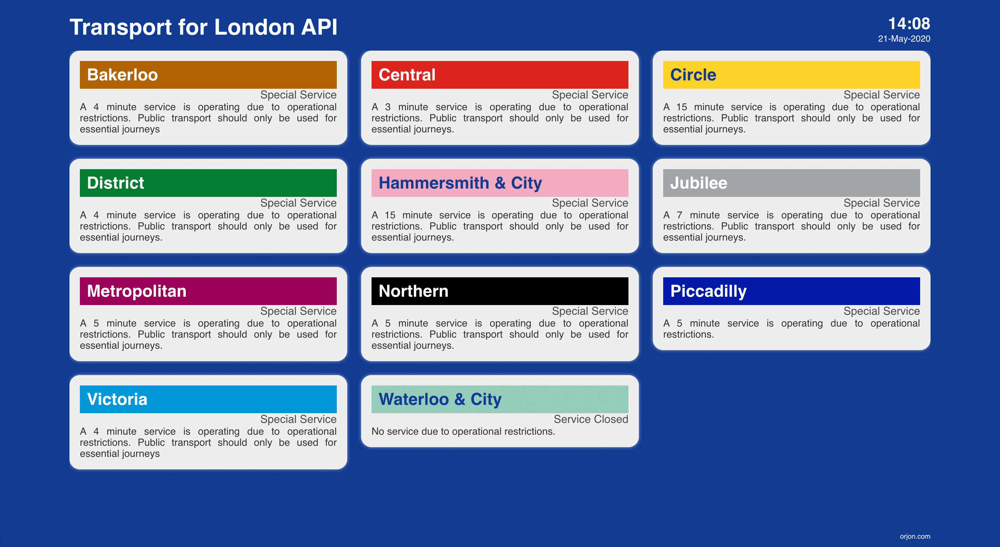
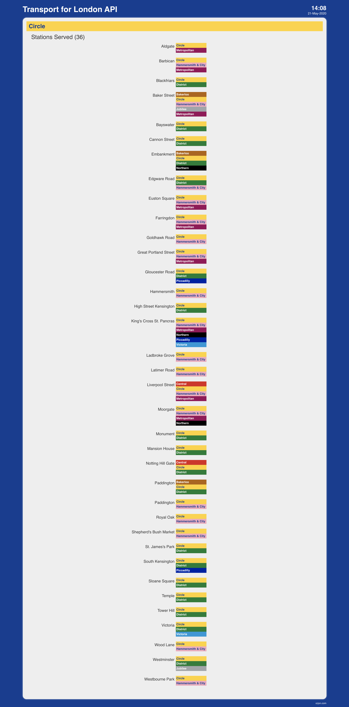
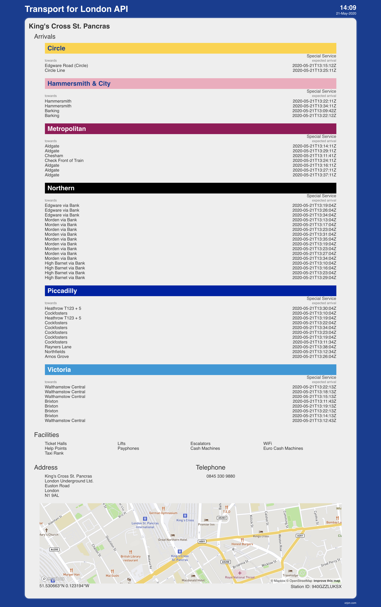

# SetOff
### London train times: live line statuses and arrivals

A React app and a small Express server that collects [Transport for London API](https://api.tfl.gov.uk/) data and shows it through a simple clickable interface. It installs as a PWA.

Powered by TfL Open Data. Not affiliated with Transport for London.

## Develop

Needs Node 22 (`nvm use`) and [pnpm](https://pnpm.io) (`corepack enable`).

```sh
cp .env.example .env     # then fill in the TfL key and the Mapbox token
pnpm install
pnpm dev                 # app on http://localhost:5173/setoff/, API on :5005
pnpm build               # builds the client into client/dist
pnpm start               # server on :5005 serving the built client
scripts/smoke-test.sh http://localhost:5005/setoff
```

The app name is set by `VITE_APP_NAME`, `VITE_APP_SHORT_NAME` and `VITE_APP_TAGLINE` in `.env`.
Use `http://localhost:5173`, not `127.0.0.1`, because the Mapbox token only allows `localhost`.

## Station data

`data/stations.json` and `data/lineStations.json` are the stations the app starts with (the server
refreshes them from TfL about daily). Rebuild them with `pnpm refresh-data` after changing the lines in
`lib/lines.js`. Stations that TfL splits into several stops but passengers see as one (Edgware Road,
Hammersmith, Paddington) are merged by a hand-written list in `lib/mergedStations.js`.

## Tests

```sh
pnpm test          # server tests (tests/) and client tests (client/src/*.test.js), with Vitest
pnpm test:watch    # re-run server tests as you edit
```

The server tests call the Express app directly and replace `fetch`, so they never reach TfL; the
sample TfL responses they use are in `tests/fixtures/`. A test marked `.fails` documents a known
bug: when the bug is fixed the test turns red, and you delete the `.fails`.
`scripts/smoke-test.sh` is separate: it checks a *running* server (used in the deploy).

## Deployment

Pushing to `main` deploys to **orjon.com/setoff** (GitHub Action in `.github/workflows/deploy.yml`):
build, smoke test, copy to the droplet, restart, smoke test the live site.
nginx is configured in the [droplet-nginx](https://github.com/orjon/droplet-nginx) repo.

On the droplet the app lives in `/var/www/setoff` (server files, `.env`, `client/dist`) and runs
as the PM2 process `setoff` on port 5006. The old TubeInfo app is separate and is not touched.

### One-time setup

1. **Droplet user.** The deploy runs as its own user, `setoff`, which can only reach `/var/www/setoff`.
   Create it with `deploy/setup-droplet.sh`, run once as an admin (see the comment at the top of the script):
   `ssh <your-admin-login>@46.101.44.86 'sudo bash -s' < deploy/setup-droplet.sh`
   It installs Node 22, pnpm and pm2 for that user only, and does not touch nginx or other sites.
2. **`/var/www/setoff/.env`** (the script creates it; never commit it): set `TFL_APP_KEY` to a TfL key
   not used by the other app. It also holds `PORT=5006` and `BASE_PATH=/setoff`.
3. **nginx.** Merge the `/setoff` block from the droplet-nginx repo (it deploys itself on push).
4. **GitHub repo secrets** (Settings, Secrets and variables, Actions): `DROPLET_USER` = `setoff`,
   `DROPLET_IP`, `SSH_PRIVATE_KEY` (the private half of the key whose public half is in
   `deploy/setup-droplet.sh`; kept in `~/.ssh/setoff_deploy` on the maintainer's Mac) and
   `MAPBOX_TOKEN` (a public `pk.` token restricted to `https://orjon.com`).
   Optional variables: `APP_NAME`, `APP_SHORT_NAME`, `APP_TAGLINE`.

### Statuses / Home 
Shows Underground line statuses in cards.
 - Cards are links to line information pages


### Line information
Line information and list of stations served
 - Stations and their lines are all clickable

Features to add:
 - Display line information and statistics.
 - Route diagram


### Station information
Station information page with upcoming expected train arrival for each line served, list of available facilites and location on map.
 - Line headers are clickable links to line information pages.
 - Interactive map is rendered with Mapbox.


### Header
The header is always displayed. Clicking on the App title links to Statuses / Home.
The current local time and date are displayed top-right